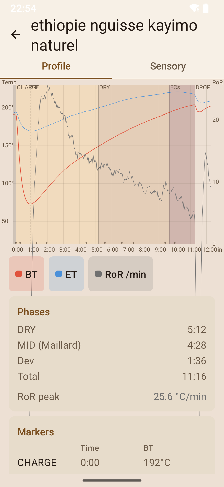
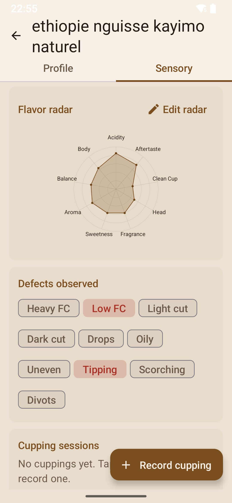

# Artisan Companion

[](LICENSE)
[](https://github.com/gpotdevin/artisan_companion_app/releases)

**Artisan Companion — sensory annotation and profile viewer for Artisan roast logs**

A native Android app for [Artisan](https://artisan-scope.org/) users who log their
coffee roasts as `.alog` files and want to attach **sensory information** (cupping
notes, flavor radar scores, defects) to each roast, and to **review roast profiles**
(BT/ET curves, Rate of Rise, event markers) — all fully offline on the phone.

## Features

- **Roast library** — browse and search your imported `.alog` files with key details (batch size, drop temperature, duration)
- **Profile viewer** — Artisan-style chart with BT/ET curves, Rate of Rise, event flags, and phase shading (DRY / FCs / DROP markers); tap legend items to toggle curves
- **Cupping recorder** — SCA-style sensory scores (fragrance, flavor, acidity, body, aftertaste, etc.), aroma descriptors, and free-text notes
- **Flavor radar** — visual radar chart of flavor attributes with a customizable editor
- **Defect tracking** — light cut, dark cut, and other defect flags per roast
- **Import & export** — import `.alog` files via Android's Storage Access Framework; export the entire sensory store as a zip for backup or transfer
- **Opt-in native sync** — write sensory fields back into `.alog` files (backup-first with `.bak`, integrity hash recomputed for Artisan 4.2+ so files load with zero warnings)
- **Offline-first** — no network permissions, no accounts, no cloud; all data stays on the device
- **Light & dark themes** — system-aware Material 3 theming
- **English & French** — full localization

## Screenshots

<p align="center">
  
  
</p>

## Download

### GitHub Release

Download the latest signed APK for direct install:

**[Download v1.0.0 APK](https://github.com/gpotdevin/artisan_companion_app/releases/download/v1.0.0/app-release.apk)** (38 MB)

Or get the AAB for sideloading via tools like APKPure or bundletool:

**[Download v1.0.0 AAB](https://github.com/gpotdevin/artisan_companion_app/releases/download/v1.0.0/app-release.aab)** (26 MB)

See all releases on the [Releases page](https://github.com/gpotdevin/artisan_companion_app/releases).

### Google Play Store

*Upcoming*

### Requirements

- Android 8.0 (API 26) or later
- ~80 MB storage (includes embedded Python runtime)

## Build from source

```bash
git clone https://github.com/gpotdevin/artisan_companion_app.git
cd artisan_companion_app/mobile/android
./gradlew assembleDebug      # debug APK
./gradlew assembleRelease    # signed release APK (requires keystore)
```

Requirements: Java 17, Android SDK (compileSdk 36), NDK 26.1.10909125.

See [`mobile/README.md`](mobile/README.md) for detailed build instructions,
release signing setup, and version numbering.

## How it works

The app is a **native Kotlin (Jetpack Compose)** Android app with an embedded
**Python core** via [Chaquopy](https://chaquo.com/chaquopy/). The proven stdlib-only
Python modules (`alog_core`, `store`, `sync`) parse `.alog` files, manage the
sensory sidecar store, and handle native sync — exposed to Kotlin through a thin
JSON facade (`mobile/android/app/src/main/python/api.py`). No Python source in
`src/` is modified for the Android build.

```
+----------------------------------------------+
|  Kotlin / Jetpack Compose UI                 |  Material 3, Canvas charts, navigation
|  (Library, Viewer, Cupping, Radar)           |
+----------------------------------------------+
|  PythonBridge (Chaquopy JSON facade)         |  api.py
+----------------------------------------------+
|  Python core (src/)                          |  alog_core, store, sync
|  embedded CPython 3.x (Chaquopy)             |
+----------------------------------------------+
```

## Desktop / Python CLI

The Python core also runs as a standalone web app on desktop (FastAPI + vanilla JS):

```bash
pip install -e ".[app]"
artisan-companion --logs-dir /path/to/your/alogs
```

Serves on `http://127.0.0.1:8000` with a library browser, profile viewer, and
sensory editor. Add the `dev` extra (`pip install -e ".[app,dev]"`) to run the
test suite (298 tests).

## Documentation

| Document | Content |
|---|---|
| [docs/mobile-port.md](docs/mobile-port.md) | Android port architecture, storage model, milestones, risks |
| [mobile/README.md](mobile/README.md) | Build instructions, release signing, version numbering |
| [docs/ci-setup.md](docs/ci-setup.md) | CI/CD setup: GitHub Secrets, keystore, release flow |
| [docs/implementation-plan.md](docs/implementation-plan.md) | Architecture, data model, tech stack, milestones |
| [docs/feasibility-evaluation.md](docs/feasibility-evaluation.md) | `.alog` format analysis and round-trip findings |
| [docs/ui-spec.md](docs/ui-spec.md) | UI specification: screens, wireframes, acceptance criteria |
| [docs/sample-gallery.md](docs/sample-gallery.md) | Gallery of 7 fixture roasts (Artisan 2.4.6-4.2.0) |
| [docs/reviews/m7-review-summary.md](docs/reviews/m7-review-summary.md) | M7 code review summary (10 findings, all resolved) |
| [docs/sdk-alignment-plan.md](docs/sdk-alignment-plan.md) | SDK alignment plan (runBeat parity) |
| [research/upstream-findings.md](research/upstream-findings.md) | Evidence from Artisan source and 230-file log corpus |
| [research/m0-roundtrip.md](research/m0-roundtrip.md) | Artisan 4.2 integrity findings and native sync design |

## Scope

The app works **offline on existing `.alog` files**, long after the roast
happened — sensory impressions arrive days or weeks later, once beans are
rested and cupped. It deliberately does **not**:

- interface with Artisan while it runs (no live telemetry, no recording,
  no daemon, no plugin or messaging connection);
- replace any part of Artisan's logging workflow.

Artisan only re-encounters the data indirectly: when the user opens an
annotated log in Artisan, the sensory summary written to the native fields
is visible there like any data entered in Artisan itself.

## Context

The `.alog` format analysis was performed against a real corpus of 230 `.alog`
files (2021-2026, Artisan versions 2.4.6 to 4.2.0) and the open-source Artisan
code base (https://github.com/artisan-roaster-scope/artisan).

## License

MIT — see [LICENSE](LICENSE).

## AI support

This app was made with support of *Mistral AI* models (Mistral Large).

I personally do not consider myself to be a good software developer. I was happy utilizing the models developed by Mistral AI to support me doing this work. I am not affiliated with the company, I simply purchased a regular subscription to use their services. I made my best to limit my token/energy consumption.

## Support

- **Issues**: [GitHub Issues](https://github.com/gpotdevin/artisan_companion_app/issues)
- **Repository**: [github.com/gpotdevin/artisan_companion_app](https://github.com/gpotdevin/artisan_companion_app)

## Affiliation

Artisan Companion is an independent project. It is not affiliated with, endorsed by, or sponsored by Artisan (artisan-scope.org). 'Artisan' is a trademark of its respective owners. This project only reads and writes the public `.alog` file format.
